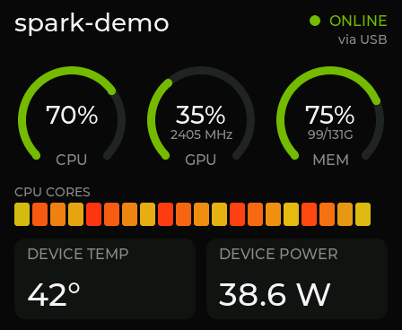
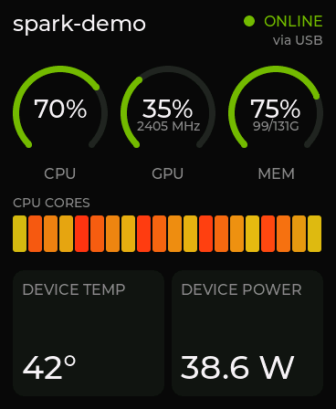

# Waveshare ESP32-S3-Touch-AMOLED-1.8 (V2)

[Product page](https://www.waveshare.com/esp32-s3-touch-amoled-1.8.htm). A small color
AMOLED that is taller than wide, so this board offers both shapes: landscape or
portrait. The C6 AMOLED stays the recommended board.

This is the **V2** hardware: a CO5300 panel controller and a CST820 touch chip. The
first version of the board (SH8601 and FT3168) has the same name and a different
panel controller; this port has not been run on one.

The demo screen (`tools/devctl.py demoshot`, load 70): landscape (`rot cw`), and portrait (`rot none`).

| | |
|---|---|
| Chip | ESP32-S3 (R8): 16 MB flash, 8 MB octal PSRAM |
| Display | 1.8" 368×448 color AMOLED, CO5300 on QSPI (40 MHz) |
| Power | AXP2101 PMIC on I2C; a TCA9554 IO expander holds the panel's power-enable and reset lines |
| USB | native USB-Serial/JTAG (303a:1001): the console and the agent's USB feed |
| Unused | CST820 touch, QMI8658 IMU, PCF85063 RTC, ES8311 audio and speaker, microphone, microSD, the battery connector |

## Pins

| Signal | GPIO |
|---|---|
| I2C SCL / SDA (AXP2101 `0x34`, TCA9554 `0x20`) | 14 / 15 |
| LCD SCLK | 11 |
| LCD D0–D3 | 4, 5, 6, 7 |
| LCD CS | 12 |
| LCD reset, panel power, touch reset | TCA9554 pins 0, 1, 2 |

## How the display works here

- `board.c` brings the board up in the order the panel needs: the AXP2101's rails
  (DC1 and ALDO1 at 3.3 V), then the panel's power and one reset pulse through the
  TCA9554, then the panel. Both chips take a handful of register writes, in `pmic.c`,
  so neither has a driver.
- The panel driver is Espressif's `esp_lcd_co5300`. The 368 visible columns start at
  column 16 of the controller's memory (`esp_lcd_panel_set_gap`). The controller's
  memory is blacked out before the panel is switched on.
- The pins, the init sequence and the PMIC values are those of the
  [xiaozhi-esp32](https://github.com/78/xiaozhi-esp32) board file for this hardware
  (`main/boards/waveshare/esp32-s3-touch-amoled-1.8-v2/`, MIT), used as facts; the
  code is our own.
- The CO5300 can't exchange rows and columns. LVGL renders the canvas the viewer sees,
  in strips, and `display.c` turns each strip into the panel's orientation on its way
  into a DMA buffer, byte-swapped to big-endian RGB565. LVGL's own buffer is never
  sent, so it sits in PSRAM.
- The panel needs window starts on even and ends on odd coordinates (`round_area_cb`).
  A window that breaks this shows as scrambled text on whatever was redrawn.
- Rotations: `rot cw` (the default) and `rot ccw` are landscape, 448×368, one the other
  turned 180 degrees; `rot none` is portrait, 368×448, the panel's own way up. `ui.c`
  has a layout for each shape.

## Verified

On the real board, 2026-11-23 (firmware 1.4.1, ESP-IDF 5.5.6), driven from a DGX Spark:

- flashes over USB, boots, answers the handshake (`board=waveshare-esp32s3-amoled-1.8-v2`)
- demo screenshots at loads 0, 70 and 100, landscape and portrait: every element in
  place, nothing clipped
- `rot cw`, `rot ccw` and `rot none` each redraw in their shape, and the choice persists
- a reflash keeps the name and the rotation
- the installer on the Spark (`--no-flash`, on a board already flashed): the agent
  streams over USB and `/healthz` reads `"state": "streaming"`

Not yet: the physical screen looked at by a person, a cold plug-in, Wi-Fi, and the
installer flashing a board that still has other firmware (`--board`).
